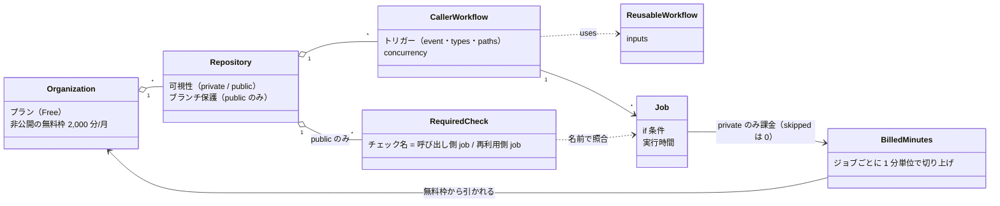

# CI 実行分数の削減（設計）

非公開リポジトリの GitHub Actions の消費を減らすため、PR の検査を 1 ジョブにまとめた再利用ワークフローを追加する。
このページは設計成果物（オントロジー図・要件定義・テストシナリオ・設計・ロードマップ）の正本。

## 背景

- tinayrum は Free プランなので、非公開リポジトリの Actions は月 2,000 分まで（[Free プランの制約と対策](index.md#free-plan)）。
- 使用量は 2026-10 が Linux 1,412 分、2026-11 が 11/18 時点で 711 分。上限には届いていないが、10 月は 7 割を使った。
- 課金はジョブごとに 1 分単位で切り上げられる。共通 CI は PR ごとに 1 分未満の短いジョブを 6 本（Docs build・Commit message・PR title・Docs as Code・Branch name・Auto Labeler）起動するため、実行時間の合計より課金が大きく膨らむ。
  同じ構成の別の Organization では、実行時間 373 分に対して課金が 906 分（約 2.4 倍）だった。
- そのほかの内訳
    - CI のトリガーに `edited` があり、PR のタイトルや本文を直しただけで全ジョブが再実行される。
    - develop への push でも docs ビルドがもう一度走る。
    - 連続して push しても古い実行が止まらない。

公開リポジトリ（`.github`・`temp`）の Actions は無料なので、この対策の対象は非公開リポジトリだけ。

## オントロジー図



課金はジョブの数で決まる。一方で、公開リポジトリの必須チェックはジョブ名で照合される。そのため、既存の再利用ワークフローのジョブ名は変えずに、新しい再利用ワークフローを追加して、非公開リポジトリだけを移す。

## 要件定義

| ID | 要件 |
| :--- | :--- |
| R1 | 既存の `reusable-ci.yml`・`reusable-check-branch.yml` は変えない。必須チェックを持つ `.github`・`temp` に影響を出さない。 |
| R2 | 新しい `reusable-pr-checks.yml` は、ブランチ名とマージ先・PR タイトル・コミットメッセージ・Docs as Code・自動ラベル・docs ビルドを、今と同じ判定のまま 1 ジョブで行う。 |
| R3 | PR の本文だけを編集したときは、ジョブを 1 本も実行しない。タイトルかマージ先を変えたときは、検査ジョブだけを再実行する。 |
| R4 | 同じ PR に新しい push が来たら、実行中の古い run を取り消す。本文の編集では取り消さない。 |
| R5 | docs と Markdown だけの変更では、リポジトリ固有のテストを起動しない（非公開リポジトリはブランチ保護がないので `paths-ignore` を使える）。 |
| R6 | develop への push では検査ジョブと docs ビルドを実行しない。リポジトリ固有のテストだけを行う。 |
| R7 | Docs as Code 検査は、日本語など ASCII 以外の名前のファイルを正しく判定する（#20・#21 と同じ不具合を新しいワークフローには持ち込まない）。 |
| R8 | `skip-docs` ラベルを付けて再実行したら通る（再実行では起動時のイベントのラベルが使われるため、API で今のラベルを取る）。 |
| R9 | 効果の目標：非公開リポジトリで、PR への push 1 回あたりの課金分を 50% 以上減らす。 |

## テストシナリオ

検証には非公開リポジトリ 1 件（timesheet-checker-py）を使う。T1 と T13 は対象の 4 件すべて。

| ID | 手順 | 合格条件 |
| :--- | :--- | :--- |
| T1 | 対象 4 件の `.github/workflows/` を `reusable-ci.yml` と `reusable-check-branch.yml` で検索する | 0 件 |
| T2 | `feature/*` → develop の PR を作る（src と docs を両方変更） | 「PR checks」1 ジョブとリポジトリ固有のテストだけが走り、成功する |
| T3 | 不正なブランチ名で PR を作る | PR checks が失敗し、ログにブランチ名のエラーが出る |
| T4 | 規約に合わない PR タイトルで PR を作り、次にタイトルを直す | 作成時は失敗する。直すと PR checks だけが再実行されて成功し、テストの run は起動しない |
| T5 | PR の本文だけを編集する | 課金されるジョブが 0 本。実行中の run は取り消されない |
| T6 | PR に続けて 2 回 push する | 1 回目の run が cancelled になる |
| T7 | docs だけを変えた PR を作る | テストの run が起動しない。PR checks は走り、docs ビルドが成功する |
| T8 | develop → main の PR を作る | PR タイトル検査とコミット検査は実行されない |
| T9 | develop にマージする（push） | テストだけが走り、PR checks は走らない |
| T10 | src と、日本語の名前の docs ファイルだけを変えた PR を作る | Docs as Code が成功する |
| T11 | src だけを変えた PR を作り、`skip-docs` ラベルを付けて再実行する | 最初は Docs as Code で失敗し、再実行すると成功する |
| T12 | `.github`・`temp` の PR を作る | 既存の必須チェックが今までどおり報告され、マージできる |
| T13 | 2026-12 第 1 週の課金レポートを集計する | PR への push 1 回あたりの課金分が 2026-11 と比べて 50% 以上減っている |

## 設計

### このリポジトリ

| ファイル | 変更 |
| :--- | :--- |
| `.github/workflows/reusable-pr-checks.yml` | 新規。各検査を 1 ジョブ「PR checks」のステップとして順に実行する。前のステップが失敗しても後のステップを実行し（`!cancelled()`）、すべての失敗を 1 回で見せる。入力は `reusable-ci.yml` と `reusable-check-branch.yml` の入力を引き継ぎ、`labeler`（自動ラベルの有無）を足す。 |
| `reusable-ci.yml`・`reusable-check-branch.yml` | 変えない（R1）。先頭コメントに、非公開リポジトリでは `reusable-pr-checks.yml` を使うよう書き足す。 |
| `docs/admin.md`・`docs/index.md` | Free プランの対策と、非公開リポジトリの CI 構成を書き足す。 |

ジョブの起動条件（R3）は次のとおり。

```yaml
if: >-
  github.event.action != 'edited'
  || github.event.changes.base != null
  || github.event.changes.title != null
```

### 非公開リポジトリ（4 件）

| ファイル | 変更 |
| :--- | :--- |
| `.github/workflows/pr-checks.yml`（新規） | `pull_request`（opened / synchronize / reopened / edited）で `reusable-pr-checks.yml@main` を呼ぶ。concurrency は PR 番号ごとに 1 グループとし、本文だけの編集は別グループにする（R4）。 |
| `check_branch.yml`、`pr-labeler.yml` | 削除する（PR checks に統合）。 |
| `ci.yml` | 共通 CI の呼び出しを外し、リポジトリ固有のテストだけを残す。`edited` を外し、`paths-ignore`（`docs/**`、`**/*.md`、`mkdocs.yml`）と concurrency を足す。テストを持たないリポジトリ（robot-sim-teleop、prod-quadruped-gait）では削除する。 |
| `docs/development.md` など | ワークフロー名と検査の場所の記述を合わせる。 |

PR への push 1 回で走るジョブは、テストを持つリポジトリで 7 本から 2 本に、持たないリポジトリで 6 本から 1 本に減る。

### 関連する Issue との関係

| Issue | 扱い |
| :--- | :--- |
| #20・#21（Docs as Code が日本語名のファイルを見落とす） | 新しいワークフローでは直した状態で作る（R7）。既存の `reusable-ci.yml` の修正は #20 で行う。 |
| #18（src-path を複数指定） | 新しいワークフローにも同じ入力が要る。#18 の対応時に両方に入れる。 |
| #17（Node.js 24 対応の版に上げる） | 新しいワークフローも、既存と同じ版から始める。#17 の対応時に両方を上げる。 |
| #19（共通 CI に試験の準備の入力） | 新しいワークフローは検査だけで試験を含まないため、影響しない。 |

### 適用の順序

呼び出し側は `@main` を参照する。このリポジトリの変更を先に main に入れてから、各リポジトリの PR をマージする。
テンプレート（`temp`）は必須チェックの名前が変わるため、今回は変えない。新しいリポジトリでも新しい構成を使うかどうかは、効果を確かめてから別の Issue で決める。

## TODO・ロードマップ

| 時期 | 作業 | 担当 |
| :--- | :--- | :--- |
| 11/18 | 設計（このページ）、G1 着手承認 | Claude → 本人 |
| 11/19 | このリポジトリに `reusable-pr-checks.yml` を追加して PR、G2、main にマージ | Claude → 本人 |
| 11/19〜11/20 | timesheet-checker-py で PR を作り、T1〜T12 を確認。G2 で develop にマージ | Claude → 本人 |
| 11/20〜11/25 | 残り 3 件に展開、G2 | Claude → 本人 |
| 12/1〜12/7 | T13 の効果測定、報告 | Claude |
| 後日（別 Issue） | `temp` にも新しい構成を入れるか（必須チェック名の更新を含む） | 要確認 |
