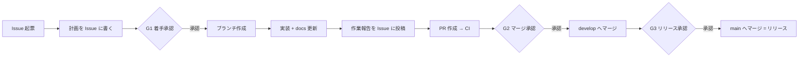

# 開発者ガイド

---

!!! info "正本"
    開発ルールの正本は [temp の `docs/development.md`](https://github.com/tinayrum/temp/blob/main/docs/development.md) です。
    テンプレートから作ったリポジトリには同じページが入っています。このページはその要約です。食い違いがあれば正本に従ってください。

## 基本方針

- **Issue 駆動**：起票・相談・進捗・報告はすべて GitHub Issue で行う。1 Issue = 1 ブランチ = 1 PR。
- **main ＝ リリース / develop ＝ ステージング**：日々の変更は develop に集め、リリース時に main へ反映する。どちらにも直接 push しない。
- **Docs as Code**：`src/` を変えた PR では `docs/` も更新する。
- **CI 必須**：CI が通らない PR はマージしない。

## Issue 駆動の進め方と承認ゲート



| ゲート | タイミング | 選択肢の例 |
| :--- | :--- | :--- |
| G1 着手承認 | 計画を Issue に書いた後 | 承認して着手（推奨）/ 計画を修正 / 中止 |
| G2 マージ承認 | PR 作成・CI 通過・作業報告の後 | develop にマージ（推奨）/ 修正してから再確認 / 保留 |
| G3 リリース承認 | develop の確認後 | main にリリース（推奨）/ 延期 / 一部だけ release/ で出す |

承認・質問は **選択肢方式**（1 回 1〜4 問、各 2〜4 択、推奨案を先頭に「（推奨）」付きで）で行い、回答を Issue に残します。

```markdown
### 質疑記録
- 問い: <質問文>
- 選択肢: A（推奨）/ B / C
- 回答: B
- 次の行動: <回答を受けて何をするか>
```

## 作業報告

区切り（計画完了・実装完了・PR 作成・マージ後）ごとに Issue にコメントし、PR 本文の「作業報告」にも同じ内容を書きます。

```markdown
## 作業報告（<フェーズ名>）
- 対象 Issue: #<番号> / ブランチ: <branch> / PR: #<番号>
- 変更したファイル:
- 実行したコマンドと結果:
- 確認できていないこと:
- 次のアクション:
```

## ブランチ

| Prefix | 用途 | 分岐元 | マージ先 |
| :--- | :--- | :--- | :--- |
| `feature/` | 新機能（Minor） | `develop` | `develop` |
| `bugfix/` | バグ修正（Patch） | `develop` | `develop` |
| `docs/` | ドキュメントのみ（Patch） | `develop` | `develop` |
| `chore/` | メンテナンス（Patch） | `develop` | `develop` |
| `release/` | リリース準備 | `develop` | `main` → `develop` に戻す |
| `hotfix/` | 緊急修正 | `main` | `main` → `develop` に戻す |
| `develop` | ステージング | `main` | `main`（リリース） |

組み合わせは CI（`check_branch.yml`）が検査します。

!!! note "`.github` リポジトリは main のみ"
    このリポジトリ（`.github`）は develop を持たず、作業ブランチから main へ直接 PR を出します。CI は prefix だけを検査します。

## コミットと PR タイトル

- 形式は `type(scope): subject`（type：`feat` / `fix` / `docs` / `chore` / `refactor` / `test` / `ci`、scope は任意）。
- PR タイトルも同じ形式にします。マージは squash で、コミット名は PR タイトルになります。
- develop → main（リリース）の PR は、develop で検査済みのためコミット・タイトル検査を行いません。

## 共通 CI

各リポジトリのワークフローは `.github` の再利用ワークフローを呼び出します。

| 再利用ワークフロー | 内容 |
| :--- | :--- |
| `reusable-ci.yml` | `mkdocs build --strict`、コミットメッセージ・PR タイトル検査、Docs as Code 検査 |
| `reusable-check-branch.yml` | ブランチ名 prefix とマージ先の組み合わせ検査 |
| `reusable-release-drafter.yml` | main への push でリリースノート・タグを作成（`GITHUB_TOKEN`） |

```yaml
jobs:
  ci:
    uses: tinayrum/.github/.github/workflows/reusable-ci.yml@main
    with:
      python-version: "3.12"
```

入力（`inputs`）の一覧は各ワークフローの先頭コメントを参照してください。

Docs as Code 検査が不要な PR は `skip-docs` ラベルを付け、理由を PR 本文に書きます。
