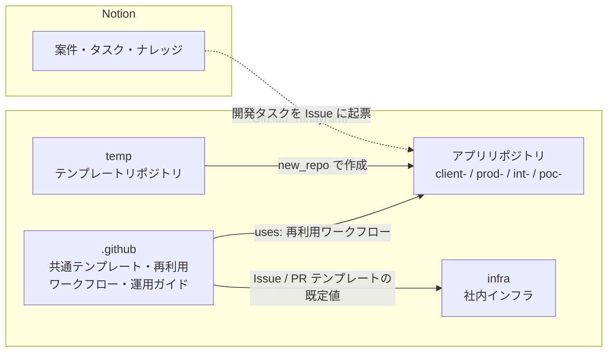

# 運用ガイド Home

---

!!! info "本ガイドの目的"
    tinayrum Organization の GitHub 運用（リポジトリの作り方・開発ルール・共通 CI）の標準を示します。

## 役割分担

| 道具 | 担当すること |
| :--- | :--- |
| **Notion** | 案件・タスク・作業ログ・文書・ナレッジの管理 |
| **GitHub** | コード、開発タスク（Issue）、リポジトリ内のドキュメント（Docs as Code） |

開発に関する起票・相談・承認・作業報告は GitHub Issue で行い、コードとドキュメントは同じ PR で更新します。

## 全体像

- **新しいリポジトリ**は、テンプレート `temp` から `tools/new_repo` で作ります（[管理者ガイド](admin.md)）。
- **共通 CI** は `.github` の再利用ワークフローで配布し、各リポジトリは呼び出すだけにします。
- **開発ルール**の正本は temp の `docs/development.md` です（要約は[開発者ガイド](developer.md)）。

## リポジトリ構成

| リポジトリ | 公開 | 役割 |
| :--- | :--- | :--- |
| `.github` | Public | 組織プロフィール（`profile/README.md`）、共通の Issue / PR テンプレートとラベル、再利用ワークフロー、`tools/new_repo`、本ガイド |
| `temp` | Public | テンプレートリポジトリ。新規リポジトリの雛形（CI・テンプレート・docs・AI エージェント向けの指示） |
| `infra` | Private | 社内インフラの構成管理 |
| `client-*` / `prod-*` / `int-*` / `poc-*` | 原則 Private | アプリケーション。下の命名規則に従う |

## 命名規則 { #naming }

| Prefix | 用途 | 例 |
| :--- | :--- | :--- |
| `client-` | 受託開発 | `client-sample-app` |
| `prod-` | 自社プロダクト | `prod-sample` |
| `int-` | 社内ツール | `int-sample-tool` |
| `poc-` | 検証・PoC | `poc-sample` |

- prefix の後ろは小文字英数字とハイフン（`^(client|prod|int|poc)-[a-z0-9]+(-[a-z0-9]+)*$`）。
- 管理用リポジトリ（`.github`・`temp`・`infra`）は対象外です。
- `tools/new_repo` は合わない名前に警告を出します（作成は止めません）。

## Free プランの制約と対策 { #free-plan }

tinayrum は GitHub Free プランです。

| 制約 | 対策 |
| :--- | :--- |
| 非公開リポジトリではブランチ保護・ルールセットが使えない | CI（ブランチ名・マージ先・コミット形式の検査）を必須とし、「main / develop へ直接 push しない」を運用ルールにする。公開リポジトリ（`.github`・`temp`）はブランチ保護を設定する |
| 非公開リポジトリでは Organization Secret が使えない | Secret を前提にしない。Release Drafter などは `GITHUB_TOKEN` で動かす。どうしても必要な場合はリポジトリ単位の Secret にする |
| 非公開リポジトリの Actions 実行時間に上限がある（月 2,000 分） | 共通 CI は軽く保つ（docs ビルドと lint が中心）。重い試験は必要なリポジトリだけに足す |
| 非公開リポジトリでは GitHub Pages を公開できない | 公開ガイドは `.github`（Public）に置く。アプリの docs は CI で `mkdocs build --strict` を通し、閲覧は `mkdocs serve` で行う |
| CODEOWNERS によるレビュー必須化が使えない（非公開） | レビュー担当は CODEOWNERS に書いて自動アサインに使い、承認は Issue の承認ゲート（G2）で記録する |

再利用ワークフローは Public の `.github` に置いているため、非公開リポジトリからも呼び出せます。

## 目次

- [管理者ガイド](admin.md) — リポジトリの作り方、既存リポジトリへの後付け設定、Organization 設定
- [開発者ガイド](developer.md) — 開発ルールの要約
- [ツール仕様](tools.md) — `tools/new_repo` の仕様
